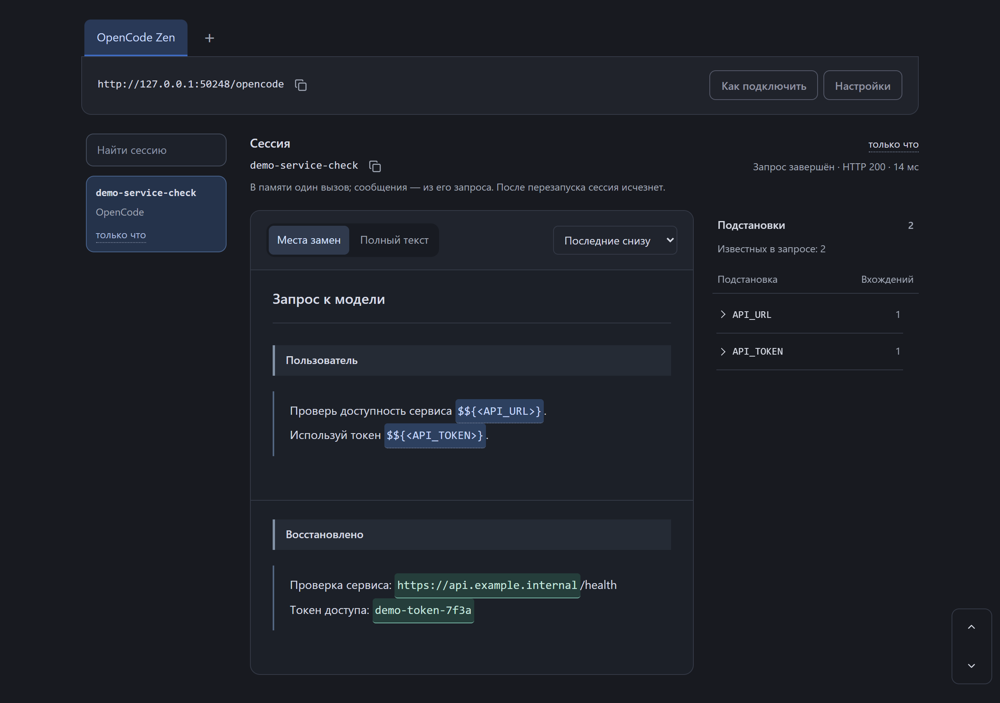

# CorpGate

**CorpGate** is built first and foremost for developers and engineering teams in corporate networks where AI coding agents (Claude Code, Codex CLI, OpenCode, Cursor, and any OpenAI/Anthropic/Gemini-compatible client) **already route model traffic through a custom `BASE_URL`** (corporate LiteLLM, Azure OpenAI, Bedrock/Vertex gateway, internal AI proxy, or a dedicated API key) rather than consumer web subscriptions.

```text
AI Client -> CorpGate (127.0.0.1:8767/<connection>) --[masks secrets to $${<VAR>}]--> Corporate LiteLLM / Custom BASE_URL
                                                     <--[restores real values in responses, SSE & tool calls]--
```

CorpGate adds a local protection layer against accidental secret leaks to cloud LLMs while letting AI agents work directly with real files, configs, and services. Registered and auto-detected values are replaced at the local proxy boundary with deterministic symbolic variables (`$${<VAR>}`), then restored in model replies, SSE streams, and tool-call arguments for local execution.

**AI stopped replying after setup or reboot? Start with [Recovery](docs/recovery.md).**

## Use cases

- **Testing internal services behind corporate DLP filters:** Corporate security policies and gateways often block requests containing internal domains (`*.internal.net`), private IPs, or tokens, tying the AI agent's hands when debugging or testing internal APIs. CorpGate substitutes those values before traffic leaves your machine, letting your CLI agent freely call and test internal services without ever knowing the real addresses or credentials.
- **Analyzing production logs, stack traces, and configs:** Feed real logs and service configs into cloud LLMs without manual redaction. Even when credentials or JWTs are buried inside triple JSON escaping, URL-encoding, or Base64, CorpGate masks them while preserving structure and diagnostic context.
- **Working with `.env` files and local credentials without manual scrubbing:** Let your coding agent read project configs and run `curl`, database, or CLI commands with real working variables without exposing them in cloud prompt history.
- **Passing new secrets to an agent outside chat history (MCP):** Instead of pasting passwords or tokens into a chat prompt, the agent opens a local browser form so you enter the value directly into the local Vault while the agent only sees the variable name.
- **Mixed corporate networking (direct internal + proxied external):** Route internal gateways (such as corporate LiteLLM) directly (`direct`), while routing external providers through your system proxy or a custom corporate proxy with full `NO_PROXY` support, configured per connection.

## How it works

**What your local CLI / tool output sends:**

```json
{
  "url": "https://api.internal.net/v1/orders",
  "auth": {
    "username": "corp_service_user",
    "password": "s3cr3t_db_password"
  }
}
```

**What actually reaches the cloud LLM / upstream `BASE_URL`:**

```json
{
  "url": "$${<INTERNAL_API_URL>}/v1/orders",
  "auth": {
    "username": "$${<SERVICE_USER>}",
    "password": "$${<SERVICE_PASSWORD>}"
  }
}
```

| Stage | Example |
|---|---|
| Local file or tool output | `https://api.corp.internal` and a saved API token |
| Outbound request to LLM / `BASE_URL` | `$${<API_URL>}` and `$${<API_TOKEN>}` |
| Command generated by the model | `curl -s $${<API_URL>}/health` |
| Command delivered to the local client | The real service URL and token are restored |

- **Controlled analysis of production artifacts:** Send raw production logs, stack traces, and service configs to cloud LLMs without manual redaction. Even when credentials appear inside triple JSON escaping, URL-encoding, or Base64, CorpGate masks them at the proxy boundary while keeping JSON structure and diagnostic context intact.
- **Zero-knowledge symbolic variables:** Instead of destructive masks (`***` or `[REDACTED]`) that break URL parsers and CLI commands, CorpGate emits DLP-neutral `$${<NAME>}` tokens (`[A-Z0-9_]+`) that preserve prompt caching prefixes and round-trip cleanly across tool calls.
- **Full protocol coverage:** Recursive JSON string traversal across requests and responses without unmasked JSON passthrough, plus streaming restoration for OpenAI Chat Completions, OpenAI Responses, Anthropic Messages, Gemini, and the Antigravity wrapper.
- **Linear-time auto-detection:** Starter rules on `re2js` ($O(N)$, ReDoS-safe) catch RFC1918 private IPs, API keys/tokens (including JWTs), database URIs, internal URLs, and `ENV`-style assignments (`AUTO_ENV_<NAME>`), and you can add custom domains and regexes.
- **Per-connection proxy routing:** Choose `Direct`, `System proxy` (pre-filled with live `HTTP_PROXY`, `HTTPS_PROXY`, and `NO_PROXY` values), or `Custom proxy` independently for each connection.



The screenshot uses demonstration data.

## Quick start

Requirements: Node.js `>=22.13.0` (uses native `node:sqlite`).

1. **Start the local daemon and open the dashboard:**

```sh
npx -y corp-gate start
npx -y corp-gate open
```

2. **Register your existing upstream `BASE_URL`:**

In the dashboard (`http://127.0.0.1:8767/dashboard`), create or select a connection and set **Where requests go** to your existing working gateway (for example, your corporate LiteLLM URL) before changing any client setting.

3. **Verify the route independently before touching the client:**

```sh
npx -y corp-gate probe --connection PREFIX --model MODEL --api-format anthropic --credential-env EXISTING_CREDENTIAL_ENV
```

Use `--api-format openai` for OpenAI-compatible gateways and `--endpoint PATH` when your route uses a custom path. `probe` sends synthetic values to verify masking, upstream reachability, and restoration, then cleans up its test records.

4. **Point your AI client at CorpGate (and optionally add MCP):**

Copy the local connection URL from **How to connect** into your client's `BASE_URL` setting while keeping your existing authentication and model config intact. To print non-destructive MCP setup fragments for Claude Code, Codex, or Cursor:

```sh
npx -y corp-gate setup --client claude
```

Follow [Installation](docs/installation.md) for the complete step-by-step workflow (including Windows Task Scheduler, macOS LaunchAgent, Linux systemd/XDG autostart, and recovery preparation).

## Storage, privacy, and port 8767 access

- **Zero telemetry and no external servers:** All proxied traffic goes exclusively to the upstream endpoints you configure. CorpGate never sends telemetry, analytics, or secrets to third-party servers.
- **Safer than `.env` files in your repo or plaintext desktop notes:** Both **manual Vault entries** and **auto-detected secrets (`auto_secrets`, 10-day TTL)** are encrypted via your OS secret store (Windows `DPAPI` / macOS `Keychain` + `AES-256-GCM` / Linux desktop `Secret Service`), backed by SQLite `PRAGMA secure_delete = ON`, integrity triggers, and `VACUUM` cleanup. On headless Linux, Docker, or WSL2 without D-Bus, CorpGate transparently falls back to unencrypted storage instead of failing silently.
- **Port `127.0.0.1:8767` locked down without login friction:**
  - **Dashboard & Admin API (`/api/*`):** Protected by a persistent `~/.corpgate/admin.token` (`0o600`, Jupyter-style token flow). Running `npx -y corp-gate open` or invoking `corpgate_open_dashboard` opens `/?token=...`, sets a 30-day `HttpOnly; SameSite=Strict` cookie (`cg_session`), and strips the token from the browser URL. Requests from other local processes or third-party tabs without a valid `cg_session` or `Authorization: Bearer <adminToken>` receive `401`.
  - **MCP endpoint (`/mcp`):** Protected by a separate persistent `~/.corpgate/mcp-token` (`0o600`, verified via `timingSafeEqual`) and closed CORS that rejects any browser `Origin`.

## Practical notes

- **Basic Auth (`Authorization: Basic base64(user:pass)`):** To mask a Basic Auth credential as a whole, store the raw `user:pass` string in the Vault — CorpGate automatically computes and masks its `Base64` form.
- **URL-encoded body values vs. request URL query parameters:** URL-encoded secrets inside request bodies (`%2F`, `%3A`, etc.) are masked automatically. Query parameters on the upstream HTTP request URL itself (such as `?key=...` for Gemini) are intentionally left untouched so provider authentication keeps working.
- **MCP vs. proxy routing:** MCP (`corpgate_list_variables`, `corpgate_request_secret_input`) lets agents discover variable names and request local human secret input without exposing values. MCP alone does not route or mask model traffic — model requests must pass through the CorpGate proxy URL.

## Threat model and boundaries

CorpGate is designed to prevent **accidental secret leaks to cloud LLMs** when an agent reads files, inspects configs, or processes tool output.

It is **not** designed to stop deliberate steganography by a malicious local agent (for example, encoding a secret character-by-character across unrelated words or bypassing the proxy with direct outbound connections) and does not replace OS-level user isolation on an already compromised host or OS account.

## CLI commands, autostart, and optional skill

| Command | Purpose |
|---|---|
| `npx -y corp-gate start` | Start the local CorpGate daemon in the user's OS session |
| `npx -y corp-gate open` | Open the authenticated dashboard via `~/.corpgate/admin.token` (`cg_session` cookie) |
| `npx -y corp-gate status` / `stop` | Check daemon health/state or gracefully drain and stop it |
| `npx -y corp-gate doctor` | Run read-only diagnostics on runtime paths, port, and storage |
| `npx -y corp-gate probe ...` | Test masking, upstream route reachability, and restoration with synthetic values |
| `npx -y corp-gate setup [--client ...]` | Print non-destructive MCP setup snippets for `claude`, `codex`, or `cursor` |
| `npx -y corp-gate autostart [METHOD]` | Configure OS login autostart (`shortcut`, `scheduler`, `registry`, `launchagent`, `xdg`, `systemd`, `off`) |

Example route verification before switching a working client:

```sh
npx -y corp-gate probe --connection PREFIX --model MODEL --api-format anthropic|openai --credential-env ENV_NAME
```

- **Ports and paths:** Default port is `8767` (`--port` / `CORPGATE_PORT`), data directory is `~/.corpgate` (`--data-dir` / `CORPGATE_DATA_DIR`), and SQLite database is `~/.corpgate/vault.db` (`--db` / `CORPGATE_DB_PATH`). There is no silent fallback port.
- **Login autostart:** Run `npx -y corp-gate autostart` to inspect choices for your OS. Without autostart, run `npx -y corp-gate start` after reboot.
- **Optional agent skill:** Bundled at [skills/corp-gate/SKILL.md](skills/corp-gate/SKILL.md) and never installed automatically; see [Optional agent skill](docs/installation.md#optional-agent-skill).

## Build and test from source

```sh
npm ci
npm run build
npm run check:ui
npm test
npm run verify:pack
```

## Questions

- **Can an AI agent use API keys without sending actual keys to the model?** Yes. CorpGate substitutes registered values with `$${<KEY>}` at the proxy boundary and restores real values only when replies or tool arguments return to the local client.
- **Is connecting MCP enough?** No. MCP exposes variable metadata and local human input forms; model traffic must route through the CorpGate proxy `BASE_URL` for masking and restoration.
- **Where can I inspect what the model actually received?** In the dashboard's latest-call inspector (`CLI -> CorpGate` vs. `CorpGate -> Provider` vs. `CorpGate -> CLI`).

## Documentation

- [Installation and preserving a corporate BASE_URL](docs/installation.md)
- [Recovery when the AI stops replying](docs/recovery.md)
- [Architecture and security specification](docs/architecture.md)
- [Changelog](CHANGELOG.md)
- [License (MIT)](LICENSE)
